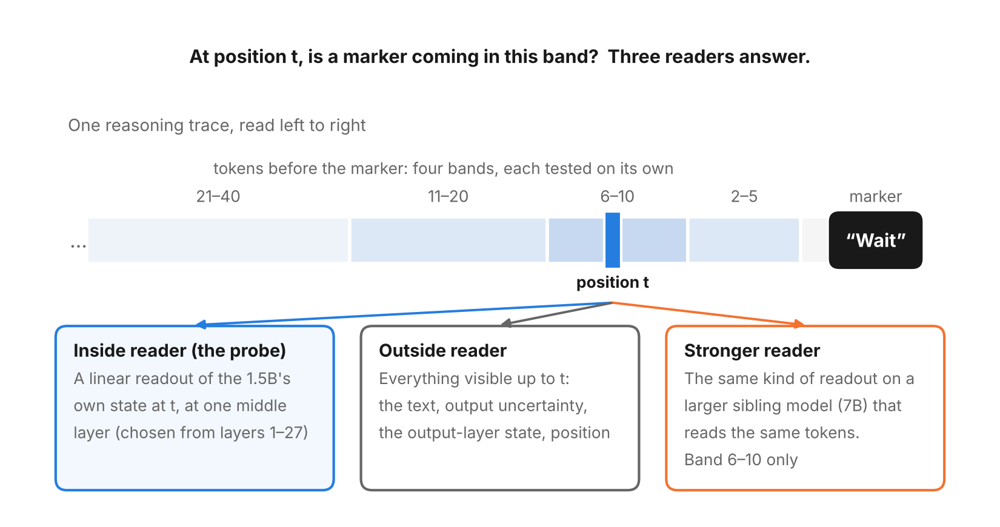
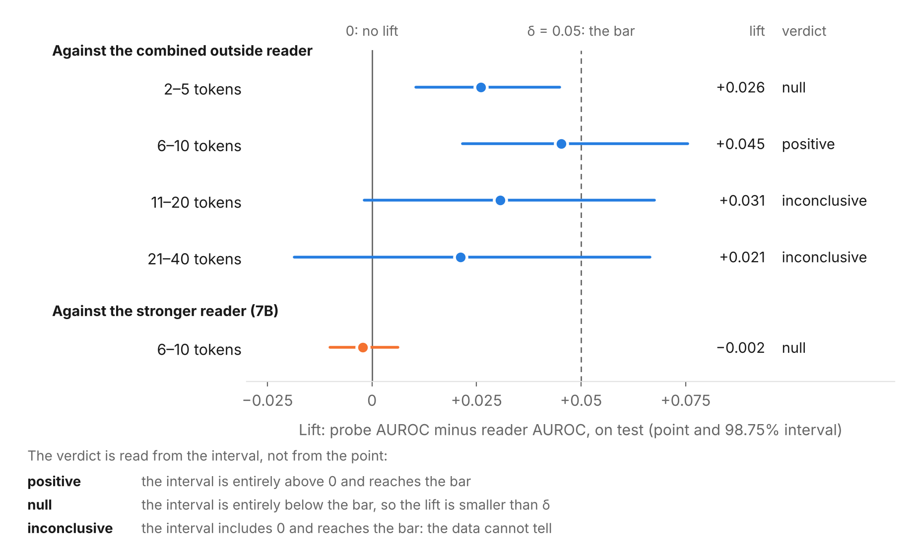
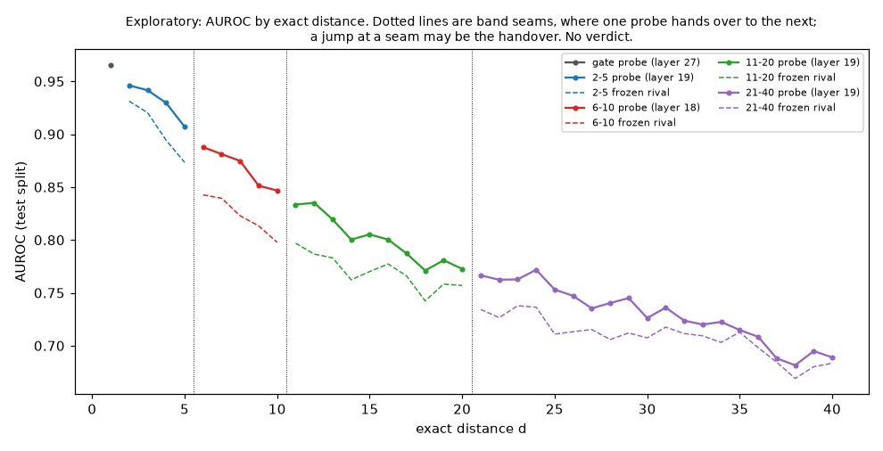

# Before the wait: does a model's inside forecast a reconsideration marker earlier than the outside does?

*Draft in progress, 2026-11-28. The abstract and the method, results and exploratory sections are complete. The introduction, related work, discussion and limitations are still being written. Sections marked **[Adeline]** are hers to write; sections marked **[drafted from the record]** were drafted by Claude from the repository files and are under her review. How AI was used is stated at the end.*

## Abstract

*Written by Adeline (2026-11-27).*

Reading a model's chain of thought is a leading proposal for monitoring it. That only works if the text keeps up with the process behind it. Re-evaluation markers such as "wait" are visible, countable events in a reasoning trace (here a fixed lexicon of 13 phrases; "wait" accounts for 71% of occurrences), so their arrival can be timed against the model's internals. In this experiment, we have DeepSeek-R1-Distill-Qwen-1.5B solve GSM8K problems and we ask: does a linear readout of the model's middle layers forecast a marker better than an outside reader (given the text so far, the model's output distribution, and position)? If so, at which distances? Each of four token bands gets its own verdict: 2–5, 6–10, 11–20 and 21–40 tokens before the marker. We find that at 6–10 tokens before the marker, our probe predicts the marker better than the outside reader (positive result with the estimate just under our pre-registered bar), while at 2–5 tokens the difference is too small to be meaningful and beyond 10 tokens our data is inconclusive. Since we built the reader, a positive result could also mean our reader is not strong enough. So we run a second test against a stronger reader (using a larger sibling model) and the probe and the stronger reader are even. For this model and this behavior, the text keeps up with the internals for a capable reader. Finally, considering the meaning of the markers, a hand audit of 100 markers finds that only 13 are followed by a visible change in the reasoning: the marker itself is rarely a sign of reconsideration. Relying only on marker counts is not a strong enough proxy for the model's reconsideration.

## 1. Introduction

**[Adeline]** The bridge from FrictionMap. The question. What is claimed and what is not (the label is the marker, not reconsideration).

**Figure 1.** **[Adeline: caption]** The setup. Band widths are schematic, not to scale.

## 2. Related work

**[Adeline]** The papers the pre-registration cites are listed in the references. The two published numbers used to set δ are in the fact sheet, section 10, with the caveat that they were extracted in October and should be checked against the papers.

## 3. Method

**[drafted from the record]**

### 3.1 Pre-registration

The design was frozen at tag `prereg-freeze` (commit `8ca3ebe`, 2026-10-24), before any probe or rival existed. Before the freeze, data was touched only to generate pilot traces, count markers, read traces, and measure the model's own next-token probabilities one token before a marker. The frozen document fixes the model, the data, the labels, the examples, the probe, the rival, the decision rule and the analyses that follow from each outcome.

Where the frozen text was silent on an implementation detail, the detail was decided and dated before the data it concerns existed. These decisions are D15 to D25 in `methodology/decisions.md` and are listed in section 8. The deviations log is empty.

### 3.2 Model and data

The model is DeepSeek-R1-Distill-Qwen-1.5B (revision `ad9f0ae0`), run in half precision on an Apple M4 Pro. It was given 320 problems drawn at random (seed 20261018) from the 1,319 problems of the GSM8K test split, with the pilot's problems excluded. Each problem was presented with no system prompt and the instruction to reason step by step and box the final answer. One trace was sampled per problem at temperature 0.6 and top-p 0.95, with at most 4,096 new tokens.

The number of traces was computed, not chosen: it is the smallest count that gives every band the minimum number of test onsets (section 3.7) under the pilot's rates, plus a 20% margin.

A trace was excluded if it looped, meaning a window of 30 consecutive generated tokens occurred three or more times verbatim. This removed 28 traces and left 292. Twenty traces that reached the length cap without looping were kept. The model's boxed answer was correct on 241 of the 292 kept traces (0.825).

The 292 problems were split by problem (seed 20261019) into 146 for training, 44 for validation and 102 for test.

### 3.3 Labels

Labels come from the FrictionMap v1 marker lexicon, 13 phrases, copied unchanged from that project at a pinned commit: *actually, wait, hmm, "no,", let me reconsider, on second thought, scratch that, hold on, reconsidering, i was wrong, let me think, now I'm realizing, however*. The lexicon's regular expression was applied to the reasoning text of each trace.

The first match in a paragraph is an **onset**. Later matches in the same paragraph merge into it. Paragraphs are the model's own, separated by blank lines. The kept traces contain 3,344 matches and 2,519 onsets, 806 of them in the test split. "Wait" accounts for 71.3% of onsets.

The label is therefore the emission of a marker. Whether a marker corresponds to a reconsideration is a separate question, measured by the audit in section 4.4.

### 3.4 Examples

An example is one token position. For each position the distance to the next onset is counted in tokens. A position is a positive for a band if its distance falls in that band (2–5, 6–10, 11–20 or 21–40) and no other match lies between it and the onset.

A negative is a position with no marker of any kind in the next 100 tokens. Positions 41 to 100 tokens before an onset are excluded from both classes. Each positive is paired with two negatives whose token is of the same kind (newline, period, comma, other punctuation, digit, word, other), taken from the same trace when one is available. Without this matching, any reader could score well by detecting the end of a sentence.

Table 1 gives the counts. The probe and every rival use exactly these examples.

**Table 1. Examples per band: positives / negatives.**

| Band | Train | Validation | Test | Test onsets |
|---|---|---|---|---|
| 2–5 | 4,955 / 9,910 | 1,820 / 3,640 | 3,191 / 6,382 | 794 |
| 6–10 | 6,028 / 12,056 | 2,164 / 4,328 | 3,861 / 7,722 | 762 |
| 11–20 | 11,623 / 23,246 | 4,134 / 8,268 | 7,453 / 14,906 | 726 |
| 21–40 | 21,656 / 43,312 | 7,776 / 15,552 | 13,907 / 27,814 | 661 |

Hidden states were extracted with a second pass of the model over the stored token ids, never over re-tokenized text, at 206,989 positions and all 28 layers.

### 3.5 The probe (the inside reader)

For each band and each of layers 1 to 27, a logistic regression with L2 regularization was fitted on the layer's state at the token, standardized with training statistics. The regularization strength was taken from a grid of five values. For each band, the layer and strength with the highest validation AUROC were chosen and then scored on test once. Layer 28, the state the output is computed from, was withheld from the probe and given to the rival.

### 3.6 The combined rival (the outside reader)

The rival is one logistic regression per band on four groups of features, all computed from tokens up to the position and nothing later:

- **Text:** TF-IDF over n-grams of the preceding token ids.
- **Visible uncertainty:** the entropy of the model's next-token distribution at the position, and its mean and maximum over the previous 16 tokens.
- **Output state:** the layer-28 hidden state, 1,536 values.
- **Position:** the token index, tokens since the previous onset, and tokens since the last paragraph break.

It was trained on the same training examples and tuned on the same validation set over a grid of text window, n-gram range and regularization strength. Table 2 gives the chosen settings.

**Table 2. Chosen probe and rival per band, with validation AUROC.**

| Band | Probe layer | Probe C | Probe AUROC | Rival window | Rival n-grams | Rival C | Rival AUROC |
|---|---|---|---|---|---|---|---|
| 2–5 | 19 | 0.001 | 0.9177 | 16 | 1–3 | 0.001 | 0.8993 |
| 6–10 | 18 | 0.001 | 0.8527 | 32 | 1–3 | 0.0001 | 0.8350 |
| 11–20 | 19 | 0.0001 | 0.7732 | 64 | 1–3 | 0.0001 | 0.7645 |
| 21–40 | 19 | 0.0001 | 0.6968 | 64 | 1–3 | 0.0001 | 0.6824 |

### 3.7 Decision rule

The measure is the **lift**: probe AUROC minus rival AUROC on a band's test examples. Its uncertainty is a 98.75% interval (95% corrected for four bands) from 10,000 paired bootstrap resamples of whole test problems.

The bar δ = 0.05 is the smallest lift treated as worth caring about. It is about a quarter of the one published gap between a probe and a text classifier (section 2). Each band receives one of three verdicts:

| Verdict | Condition |
|---|---|
| Positive | interval entirely above 0 and reaching δ |
| Null | interval entirely below δ |
| Inconclusive | interval includes 0 and reaches δ |

A null is reachable only with enough events. The minimum, computed before the run, is 555 test onsets per band; all four bands exceed it (Table 1). Verdicts at δ = 0.03 and 0.08 are reported as secondary.

### 3.8 Checks before the verdicts

- **Gate.** One token before a marker, the model's own output probabilities separate the classes with AUROC 0.946 on validation. The best probe at that distance reaches 0.960 (layer 27), inside the registered window around the model's own figure. This is a wiring check, not a hypothesis.
- **Shuffled labels.** Probes refitted on permuted training labels score 0.514, 0.538, 0.505 and 0.512 on test, inside the registered 0.45 to 0.55.

### 3.9 Analyses conditional on a positive band

Two analyses were registered to run only if a band was positive.

- **A stronger reader.** For each positive band, the hidden states of DeepSeek-R1-Distill-Qwen-7B reading the same token ids, with the probe's recipe, every layer eligible, chosen on validation (D24). The registered claim has two levels: level 1, the probe beats the combined rival; level 2, it also beats this reader.
- **A hand audit.** One hundred test onsets drawn at random (seed 20261020), each labeled real or false by one person, Adeline, before any per-onset probe score was viewed. A marker is **real** if the trace changes what it held just before the marker, visibly, in the marker's paragraph or the two that follow; a re-check that confirms is false (D23). A registered follow-up comparing probe scores before real and false markers required at least 20 of each.

## 4. Results

**[drafted from the record: tables and the factual sentences. Interpretation belongs in section 6.]**

### 4.1 Probe against the combined rival

**Table 3. Confirmatory verdicts on test.**

| Band | Probe | Rival | Lift | 98.75% interval | Verdict at δ = 0.05 | Predicted before any probe existed |
|---|---|---|---|---|---|---|
| 2–5 | 0.931 | 0.905 | +0.026 | +0.011 to +0.045 | null | positive |
| 6–10 | 0.868 | 0.823 | +0.045 | +0.022 to +0.076 | positive | positive, smaller lift |
| 11–20 | 0.801 | 0.770 | +0.031 | −0.002 to +0.068 | inconclusive | inconclusive |
| 21–40 | 0.730 | 0.709 | +0.021 | −0.019 to +0.067 | inconclusive | null |

Band 6–10 is positive: its interval excludes zero and reaches δ. Its point lift, +0.045, is below δ = 0.05. Band 2–5 is a null of the "real but under δ" kind: its interval lies entirely above zero and entirely below δ. For the two far bands the data cannot tell.

At δ = 0.03, bands 2–5 and 6–10 are positive and the far bands inconclusive. At δ = 0.08, all four are null.

**Figure 2.** Lift of the probe over each reader on test, with its 98.75% interval. The first four rows are the confirmatory verdicts (Table 3); the last row is the stronger-reader test of section 4.2 (Table 4). Drawn from `results/verdicts.csv` and `results/stronger_rival.csv`.

### 4.2 Probe against the stronger reader

The 7B reader was fitted for band 6–10 only. Its best layer on validation was 19 (AUROC 0.857).

**Table 4. Band 6–10 on test: the 1.5B probe against the 7B reader.**

| Probe (1.5B, layer 18) | 7B reader (layer 19) | Lift | 98.75% interval | Verdict at δ = 0.05 |
|---|---|---|---|---|
| 0.868 | 0.871 | −0.002 | −0.010 to +0.006 | null |

The verdict is null at 0.05, 0.03 and 0.08. Claim level 2 does not hold. This comparison scored the band's test examples a second time, as registered; the frozen probe's score reproduced exactly.

### 4.3 The audit

Of the 100 audited onsets, 13 were real and 87 false: a precision of 0.13 (95% interval 0.054 to 0.217, bootstrap over the 53 problems sampled). No item was flagged as a close call or as a lexicon mis-hit. The 13 real markers come from 9 problems.

The follow-up comparing probe scores before real and false markers was not run: it required 20 real markers.

## 5. Exploratory analyses

**[drafted from the record]**

These were registered as exploratory. They carry no verdict. Their settings were fixed after the results above were known (D25), which is the registered order.

**Each rival group alone.** Table 5 scores each feature group of the rival by itself.

**Table 5. Exploratory. Test AUROC of each rival group alone.**

| Band | Text | Entropy | Output state | Position | Combined rival |
|---|---|---|---|---|---|
| 2–5 | 0.748 | 0.562 | 0.908 | 0.704 | 0.905 |
| 6–10 | 0.721 | 0.539 | 0.828 | 0.698 | 0.823 |
| 11–20 | 0.697 | 0.534 | 0.756 | 0.667 | 0.770 |
| 21–40 | 0.654 | 0.526 | 0.674 | 0.615 | 0.709 |

In the two near bands the output state alone scores slightly above the combined rival. The probe's lift over the output state alone at band 6–10 is +0.041 (+0.031 to +0.051).

**Exact distance.** Slicing each band's probes by exact distance, the lift at the chosen layer is above zero at every distance from 2 to 40, between +0.038 and +0.052 across band 6–10, and falling to +0.002 at distance 35. In all four bands, probes on layers 1 to 10 score below the rival on average. The probe and the rival both change at the band boundaries, so a step in the curve at 5→6, 10→11 or 20→21 may be that change.

**Figure 3.** Exploratory. Test AUROC at each exact distance, for each band's chosen probe (solid) and its frozen rival (dashed). Dotted vertical lines mark the band boundaries. The layer-by-distance heat maps are in `results/exploratory/`.

**Same-trace negatives.** Removing the negatives borrowed from other traces changes each band's lift by at most 0.002.

**Paragraph position.** Positive positions sit later in their paragraph than their matched negatives: a median of 31 to 40 tokens after the last paragraph break, against 22 or 23. In the two near bands about 73% of positives lie in the paragraph before the onset's own.

**Per-trace pages.** Ten test traces (seed 20261021) are rendered with the four probes' scores at every reasoning token in `results/exploratory/traces/`.

## 6. Discussion

**[Adeline]** What "in the text" means after section 4.2. The word, the re-check and the overturn. What the paragraph finding does to the reading of the absolute scores.

## 7. Limitations

**[Adeline]** A list to start from, each already on record:

- One model, one dataset, and a label that is mostly one word.
- The audit has one labeler, who knew which band was positive.
- The audit's definition counts only a visible change within two paragraphs.
- The probe, the rival and the 7B reader each chose the smallest regularization value in the grid in some bands, including the 7B reader and the rival at band 6–10.
- The combined rival scored slightly below its own output-state group in the two near bands.
- The 7B reader comes from the same family and teacher as the 1.5B.
- Negatives were matched on token kind, not on position within a paragraph.
- Lexicon recall was not measured.

## 8. Decisions made after the freeze

**[drafted from the record]**

Each was recommended in a planning session, decided by Adeline, and dated before the data it concerns existed. Full text and reasons are in `methodology/decisions.md`.

| ID | Date | What it fixed |
|---|---|---|
| D15 | 2026-11-13 | Where post-freeze data contact is recorded |
| D16 | 2026-11-13 | The per-band flag for too few onsets after generation |
| D17 | 2026-11-13 | No top-up of traces if a band is short |
| D18 | 2026-11-14 | Dropping unmatched positives if negatives of a kind run out (never triggered) |
| D19 | 2026-11-14 | The rival's entropy uses the raw output distribution |
| D20 | 2026-11-14 | The rival's look-back windows count the prompt |
| D21 | 2026-11-14 | The rival's implementation details, each chosen not to handicap it |
| D22 | 2026-11-15 | The verdict procedure: interval method, seeds, resampling unit |
| D23 | 2026-11-15, final 2026-11-19 | The audit procedure |
| D24 | 2026-11-21 | The stronger reader: layers, verdict rule, second test scoring |
| D25 | 2026-11-21 | How each exploratory analysis is computed |

D25 was decided after the confirmatory verdicts, the audit and the stronger-reader result were known. That is the order the pre-registration sets for exploratory work.

## Statements

**Reproducibility.** Code, traces, labels, the audit sheet and all result files are in the repository. Model weights and hidden states are rebuilt by the scripts.

**How AI was used.** **[Adeline]** The README's disclosure is the starting point. This report adds: sections 3, 4 (tables and factual sentences), 5 and 8 were drafted by Claude from the repository record and edited by Adeline; the abstract, sections 1, 2, 6 and 7 are hers.

## References

- Zhu et al., arXiv 2506.12217
- Troitskii et al., arXiv 2510.04128
- Venhoff et al., arXiv 2506.18167
- Ward et al., arXiv 2507.12638
- Yan et al. (ReflCtrl), arXiv 2512.13979
- Yuan et al. (Hidden Error Awareness), arXiv 2605.09502
- Pal et al. 2023, Future Lens, arXiv 2311.04897
- Wu, Morris and Levine 2024, "Do language models plan ahead for future tokens?", arXiv 2404.00859
